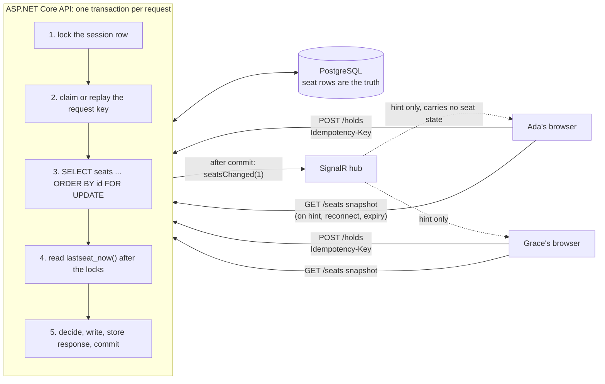

# last-seat

Open two browsers. Pick the same seat. Watch one reservation win and the other browser explain exactly what happened.

[](https://github.com/AutumnTrace/last-seat/actions/workflows/ci.yml)
[](LICENSE)


A small theatre booking system built with Angular, ASP.NET Core and PostgreSQL. The one seeded performance is sold out apart from four scattered single seats and F7 and F8, the last two seats together.

PostgreSQL decides who gets a seat. It takes row locks in seat order and judges expiry on its own clock after the locks are granted. SignalR only tells browsers when to fetch the new state.

**Try it** (Docker):

```sh
git clone https://github.com/AutumnTrace/last-seat && cd last-seat
docker compose up --build
```

Then open <http://localhost:8080> and click **Open Ada's window** and **Open Grace's window**. Without Docker, see [Running it](#running-it).

Everything here is simulated: the theatre and performance are fictional, a booking takes no payment and issues no ticket, and customers are named demo sessions rather than accounts.

## A 60-second walkthrough

1. **Race.** Put Ada's and Grace's windows side by side. In each one, click F7 and F8 (row F, centre). Press **Hold seats for 90 seconds** in both, as close together as you can.
   - One window turns amber, showing *Held for you* and a countdown.
   - The other shows *F7 and F8 went to someone else*: when its request reached the database, how long it waited for the seat lock, when it was decided, and when the other hold was made.
   - Nothing is half-held. The loser is offered the two closest free seats, since no other pair is left.
2. **Confirm.** In the winning window, press **Confirm booking**. You get a reference like `LS-7KQ2MX`, and the other window's map greys out F7 and F8 within a moment.
3. **Expire.** Press **Reset demo** in the [box office](http://localhost:8080/box-office). Hold F7–8 in Ada's window, then press **Skip ahead 90 s** in the box office.
   - Ada's window says *Your hold on F7–8 ran out at …*.
   - The seats come back in every window.
4. **Pause cleanup.** Do step 3 again, but press **Pause cleanup** first.
   - The box office now lists Ada's hold as *expired; seats still marked until the sweep runs, free to take*.
   - Grace can still hold F7–8, because expiry is decided when a seat is locked, not by the sweep.
5. **Keyboard.** Reload a window and press Tab until a seat has focus.
   - The arrow keys move between seats, **N** jumps to the next free seat, Space selects, and Tab reaches the Hold button.
   - After the hold, focus lands on Confirm.
   - **List** switches to the same house as plain checkboxes.

The box office's decision log shows each request: database time, customer, outcome and lock wait.

The second recording shows a stale browser. Ada's tab loses contact and keeps showing a hold that has run out. Grace takes the seats, and Ada's Confirm is refused with the reason.


## How a seat is decided



The hard decision is where a seat's fate is settled: in one PostgreSQL transaction per request, on the seat rows themselves. The API and the browsers only follow from that.

- **Locks in a stable order.** Every transaction that changes seats locks them ordered by id. Two overlapping group requests queue on their lowest shared seat instead of deadlocking, and the loser writes nothing, so a group gets all its seats or none.
- **One clock, read after the locks.** `lastseat_now()` is `clock_timestamp()`. It is not `now()`, which is frozen at transaction start. A confirmation that queued behind a lock past its hold's expiry loses, because "expired" is judged at the moment the decision is made. [docs/design-note.md](docs/design-note.md) walks through the confirm-versus-expire race in detail.
- **Expiry needs no cleanup to be correct.** An expired hold counts as free for allocation and in the snapshot. The sweep only tidies the columns and sends a hint, and it skips locked rows so that it never waits.
- **Request keys bound to a session.** Each user action carries one key. Retries replay the stored response byte for byte, and reusing a key for a different payload gets a 422. A hold can only be confirmed or released by the session that owns it, and another session's hold id is answered with 404.
- **SignalR is only a hint.** A browser never trusts a message for seat state. It fetches the snapshot, one fetch at a time, so an old response can't overwrite a newer one. It also refetches after every reconnect and just after the earliest visible hold expires.

## Failure scenarios and the tests that pin them

The .NET tests run against real PostgreSQL: Testcontainers in CI, or any server you point them at. The browser tests drive the real API and Angular build with Playwright.

| Scenario | What must happen | Test |
| --- | --- | --- |
| 50 sessions race for one seat, five rounds | Exactly one hold per round. The 49 losers are told the seat was held, and when. | [`Fifty_sessions_racing_for_one_seat_produce_exactly_one_hold`](tests/LastSeat.Api.Tests/AllocationRaceTests.cs#L10) |
| A group overlaps a seat someone holds | No seat of the group is held. The free ones are reported as still available. | [`An_overlapping_group_request_leaves_no_partial_allocation`](tests/LastSeat.Api.Tests/AllocationRaceTests.cs#L42) |
| 30 random groups race, 8 rounds | Every open hold owns exactly the seats it asked for. | [`Racing_overlapping_groups_get_all_their_seats_or_none`](tests/LastSeat.Api.Tests/AllocationRaceTests.cs#L59) |
| Requests name the same seats in opposite orders | No deadlock, one winner. | [`Requests_naming_seats_in_opposite_orders_do_not_deadlock`](tests/LastSeat.Api.Tests/AllocationRaceTests.cs#L102) |
| Confirm 1 ms before expiry, and exactly at expiry | The first books, the second is `hold_expired`. | [`A_confirmation_one_millisecond_before_expiry_wins_and_one_at_expiry_loses`](tests/LastSeat.Api.Tests/ExpiryTests.cs#L12) |
| A confirm starts in time, then queues behind a lock past expiry | Loses: judged by the clock after the lock. Fails if you switch to the transaction-start clock. | [`A_confirmation_queued_behind_a_lock_is_judged_by_the_clock_after_the_lock`](tests/LastSeat.Api.Tests/ExpiryTests.cs#L57) |
| A hold expires while cleanup is paused | Another session can take the seats. | [`An_expired_hold_can_be_taken_while_cleanup_is_paused`](tests/LastSeat.Api.Tests/ExpiryTests.cs#L33), [`expiry.spec.ts`](e2e/tests/expiry.spec.ts#L28) |
| The sweep meets a seat locked by a decision | Skips it without waiting. | [`Cleanup_skips_a_seat_that_a_decision_has_locked`](tests/LastSeat.Api.Tests/ExpiryTests.cs#L126) |
| A stale browser confirms after another customer took the seats | `hold_expired`, listing the new holder. The new owner's hold id gets 404. | [`A_stale_browser_cannot_confirm_the_new_owners_hold`](tests/LastSeat.Api.Tests/SessionBindingTests.cs#L10), [`expiry.spec.ts`](e2e/tests/expiry.spec.ts#L56) |
| A request is retried with the same key, 20 at once | One hold. Every response is identical, and 19 are marked replayed. | [`Concurrent_retries_with_one_key_create_one_hold`](tests/LastSeat.Api.Tests/RequestKeyTests.cs#L42) |
| A key is reused for a different payload | 422, and nothing changes. | [`Reusing_a_key_for_a_different_payload_is_refused`](tests/LastSeat.Api.Tests/RequestKeyTests.cs#L25) |
| Confirm is retried, or ten tabs confirm at once | One booking, one reference. | [`Confirmation_is_idempotent_with_or_without_the_same_key`](tests/LastSeat.Api.Tests/RequestKeyTests.cs#L58), [`Concurrent_confirmations_book_once`](tests/LastSeat.Api.Tests/RequestKeyTests.cs#L77) |
| The refresh hint arrives | The snapshot fetched in response already shows the change. | [`A_refresh_hint_arrives_after_the_change_is_visible`](tests/LastSeat.Api.Tests/ApiTests.cs#L139) |
| A browser misses hints while disconnected | It refetches the snapshot on reconnect. | [`reconnect.spec.ts`](e2e/tests/reconnect.spec.ts#L8) |
| Two browsers race in the UI | One hold. The other window explains, offers alternatives, and keeps the seats it can still get. | [`race.spec.ts`](e2e/tests/race.spec.ts#L6) |
| Keyboard only | Book with Tab, arrows, N, Space and Enter. axe reports no serious violations on any page. | [`keyboard.spec.ts`](e2e/tests/keyboard.spec.ts#L7) |

## Measured

Measured on Windows 11 with a Ryzen 7 9800X3D, PostgreSQL 18.4 running locally, .NET 10 (ASP.NET Core runtime 10.0.12), Node 24.21.0, and Playwright 1.65.1 with Chromium.

`npm run race` sends 50 simultaneous HTTP hold requests for F7, five rounds, each round after a reset:

| Round | Holds | Conflicts | Lock wait p50 / max | All 50 decided within | Burst |
| ---: | ---: | ---: | ---: | ---: | ---: |
| 1 (cold) | 1 | 49 | 142.6 / 196.4 ms | 127 ms | 219 ms |
| 2 | 1 | 49 | 46.2 / 82.2 ms | 88 ms | 96 ms |
| 3 | 1 | 49 | 44.5 / 83.3 ms | 86 ms | 93 ms |
| 4 | 1 | 49 | 44.0 / 82.7 ms | 83 ms | 89 ms |
| 5 | 1 | 49 | 44.1 / 83.7 ms | 86 ms | 91 ms |

The losers queue on F7's row lock and are decided one after another, about 1.7 ms apart.

Test suites on the same machine:

| Suite | Tests | Wall time |
| --- | ---: | ---: |
| .NET (xUnit, PostgreSQL) | 34 | 2 s |
| Angular unit (Vitest) | 7 | 0.5 s |
| Browser (Playwright, Chromium) | 13 | 14 s |

## Running it

Prerequisites:

- With Docker: Docker with Compose v2.
- Without Docker: [.NET SDK 10.0.100 or later](https://dotnet.microsoft.com/download), Node 24, and PostgreSQL 16 or later. Development used 18.4; CI and Compose use `postgres:18.7-alpine`.

```sh
# Without Docker. The API creates and seeds the database on first start.
npm ci
npm run demo              # builds the Angular app into the API, serves http://localhost:5080
```

The API connects to `Host=localhost;Port=5432;Database=lastseat;Username=postgres;Password=postgres`. To use another server, set `ConnectionStrings__LastSeat`.

| Task | Command |
| --- | --- |
| Reset to the seeded house | press **Reset demo** in the box office, or `npm run reset`, or `docker compose exec app dotnet LastSeat.Api.dll reset` |
| .NET tests (needs Docker for Testcontainers) | `dotnet test` |
| .NET tests on a server you already run | `LASTSEAT_TEST_DB="Host=localhost;Username=postgres;Password=postgres" dotnet test` |
| Angular unit tests | `npm test -w web` |
| Browser tests (build the web app first; starts the API itself) | `npm run build && LASTSEAT_E2E_DB="Host=localhost;Database=lastseat_e2e;Username=postgres;Password=postgres" npm run e2e` |
| The race measurement above (with `npm run demo` running) | `npm run race` |
| Re-record the media in `docs/media` | `npm run build && LASTSEAT_DB="Host=localhost;Database=lastseat_record;Username=postgres;Password=postgres" npm run record` |
| Angular dev server with live reload | `dotnet run --project src/LastSeat.Api` and `npm start -w web`, then open <http://localhost:4200> |

Each .NET test clones a fresh database from a migrated template, so tests never share state and can run in parallel. The browser tests and the recorder reset the demo before each scenario.

## Three files worth reading

1. [`src/LastSeat.Api/Allocation/SeatAllocator.cs`](src/LastSeat.Api/Allocation/SeatAllocator.cs): every hold, confirm and release transaction, in the order the rules above give.
2. [`tests/LastSeat.Api.Tests/ExpiryTests.cs`](tests/LastSeat.Api.Tests/ExpiryTests.cs): expiry tested on a frozen database clock, including a confirmation queued behind a real row lock.
3. [`web/src/app/core/seat-feed.ts`](web/src/app/core/seat-feed.ts): how the browser treats SignalR as a hint, with refreshes that never overlap and a refetch after every reconnect.

## Tradeoff, limitation, next step

**Tradeoff.** Correctness comes from PostgreSQL row locks, so every decision about a hot seat waits its turn. In the race above, 49 losers queued for a median of 44 ms. Optimistic writes (`update … where hold_id is null`) would return sooner, but the loser could then only say "someone else got it", not "you waited 41 ms behind a hold made at 19:31:04.118". For one theatre the queue is short and the explanation is the product. A stadium on-sale would need admission control in front of it.

**Known limitation.** A hint makes every open browser refetch the whole house: 140 seats, 17 KB of uncompressed JSON. That is fine for one hall and a handful of windows. It does not scale to large venues or thousands of viewers.

**Next step.** Stamp every seat change with a value from a PostgreSQL sequence, send that value in the hint, and let browsers ask for "seats changed since N". The snapshot endpoint stays the source of truth and the full fetch remains the fallback after a reconnect. This is the next step because it fixes the limitation above without moving any decision out of the database.

## Scope

- Simulated booking confirmation.
- No checkout, pricing or accounts.
- Demo sessions are a random id in a header, kept per browser tab. That id is what holds and request keys are bound to, but it is not authentication.
- The demo clock controls in the box office (`/api/demo/*`) exist to make expiry watchable. Set `Demo:Enabled=false` to remove them.

## License

[MIT](LICENSE)
