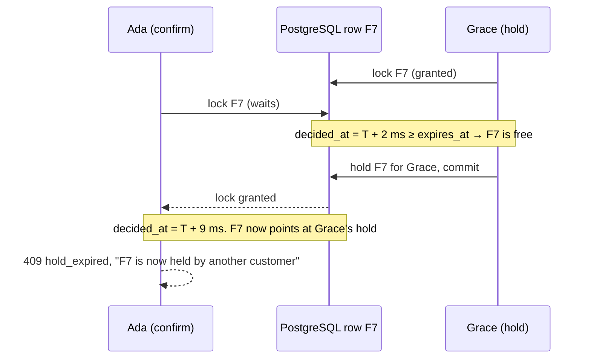

# Confirm versus expire

A hold lasts 90 seconds. Near the end of those 90 seconds three things can reach for the same seat at once: the holder pressing Confirm, another customer pressing Hold, and the sweep that clears expired holds. This note walks through how one transaction design settles every ordering of those three, and which test pins each case.

All of the code discussed here is in [`SeatAllocator.cs`](../src/LastSeat.Api/Allocation/SeatAllocator.cs) and [`HoldCleanup.cs`](../src/LastSeat.Api/Allocation/HoldCleanup.cs).

## The rules

Each hold, confirm and release is one READ COMMITTED transaction that does these steps in order:

1. **Lock the session row** (`for no key update`). One customer's requests run one at a time, which makes request-key replay and "one open hold per customer" simple.
2. **Claim the request key.** If the key was already used for the same payload, return the stored response. If it was used for a different payload, refuse with 422.
3. **Lock the seat rows, ordered by seat id** (`select … order by id for update`). Two requests that overlap queue on their lowest shared seat. They cannot each hold a seat the other needs, so they cannot deadlock.
4. **Read the clock after the locks are granted.** The clock is `lastseat_now()`, which is `clock_timestamp()`. It is not `now()`, because `now()` is the transaction's start time and stays fixed while the transaction waits for a lock.
5. **Re-read the seats and decide.**
   - A hold request treats a seat as free if it has no booking and either no hold or a hold whose `hold_expires_at <= decided_at`.
   - A confirmation succeeds only if every seat still points at its hold and `hold_expires_at > decided_at`.

The sweep follows a different rule: it uses `for update skip locked` and never waits. A seat that a decision has locked belongs to that decision.

One consequence follows from these rules. Decisions about a seat are serialised by its row lock, and each decision reads the clock while it holds that lock. Each decision therefore sees a later time than the one before it, so lock order and clock order agree. Once a hold has been judged expired, no later decision can judge it alive.

## Three orderings

Let T be the moment Ada's hold on F7 expires. All times below are database times. The millisecond values are illustrative; the tests linked below pin the same orderings on a frozen clock.

### 1. Ada's confirmation gets the lock first, just in time

| Time | Ada (confirm) | Grace (hold F7) |
| --- | --- | --- |
| T − 6 ms | locks F7 | |
| T − 5 ms | reads clock: T − 5 ms; T − 5 ms < T, so **books F7** | asks for F7, waits for the lock |
| T − 4 ms | commits | |
| T − 3 ms | | gets the lock, reads clock: T − 3 ms, sees a booking, **conflict** |

Grace's window shows that F7 was booked, plus her request time, decision time and lock wait (about 2 ms here).

### 2. Grace's request gets the lock first, just after expiry

Ada's window explains what happened: her hold ended at T, her confirmation was decided at T + 9 ms, and F7 has been Grace's since T + 2 ms. Nothing was booked for her. If Ada's tab is stale and still shows a running countdown, the result is the same, because the browser's opinion of the time is never consulted. That is the `stale-confirm` recording in the README.

### 3. The trap: a confirmation that started in time but queued past expiry

| Time | Ada (confirm) | another transaction |
| --- | --- | --- |
| T − 1 s | starts; `now()` would be fixed at T − 1 s | holds the lock on F7 |
| T − 1 s … T + 1 s | waits for F7 | (slow) |
| T + 1 s | lock granted, reads `lastseat_now()` = T + 1 s, **expired** | released |

With `now()`, Ada's transaction would compare T − 1 s against `expires_at` and book a seat whose hold had ended a second earlier. Meanwhile every snapshot taken after T had already shown F7 as free. With the clock read after the lock, the decision matches what everyone could see at that moment.

[`A_confirmation_queued_behind_a_lock_is_judged_by_the_clock_after_the_lock`](../tests/LastSeat.Api.Tests/ExpiryTests.cs) reproduces this exactly:

- It holds F7's row lock from a separate connection.
- It starts Ada's confirmation and waits until `pg_stat_activity` shows it queued.
- It moves the frozen database clock from T − 1 s to T + 1 s and releases the lock.

The confirmation comes back as `hold_expired` with a recorded lock wait of 2000 ms. If you swap the post-lock clock read for the transaction-start time, this test fails, and so does its mirror image, [`A_lock_wait_that_ends_before_expiry_still_books`](../tests/LastSeat.Api.Tests/ExpiryTests.cs).

## Where the sweep fits

The sweep (`HoldCleanup.SweepAsync`, every second) clears the hold columns of expired, unbooked seats and sends a refresh hint. Correctness does not depend on it:

- Allocation already treats an expired hold as free.
- The snapshot already shows it as available.
- [`An_expired_hold_can_be_taken_while_cleanup_is_paused`](../tests/LastSeat.Api.Tests/ExpiryTests.cs) pauses the sweep and takes the seat anyway.

The sweep exists so that other browsers learn the seat came back without waiting for an unrelated change. The browsers also schedule their own refresh for just after the earliest hold they can see expires, in case the sweep's hint is lost.

The sweep never waits for a lock (`skip locked`). Seen from the sweep, case 2 looks like this: Grace's transaction has F7 locked, the sweep skips F7, and Grace's transaction takes the seat over itself. [`Cleanup_skips_a_seat_that_a_decision_has_locked`](../tests/LastSeat.Api.Tests/ExpiryTests.cs) checks that the sweep returns immediately in that situation.

## Why one clock in the database

The API could compute expiry with its own clock. With one API process that would mostly work. With two processes whose clocks differ by 50 ms, though, a hold could be expired for one and alive for the other in the same millisecond. `lastseat_now()` puts every decision on one clock, the one that also orders the locks.

The same function is how the demo and the tests control time:

- `demo_clock.offset_ms` moves it forward. The box office's "Skip ahead 90 s" uses this, so a reviewer does not have to wait.
- `demo_clock.frozen_at` pins it to an exact instant. The tests use this, so "one millisecond before expiry" is a fact and not a `sleep`.

In production the row would stay at its defaults and the function would return `clock_timestamp()`.

## What a client is told

| Situation | Status | Body `code` | The window shows |
| --- | --- | --- | --- |
| Hold granted | 201 | | the seats, a countdown on database time, Confirm |
| Some seat held or sold | 409 | `seats_unavailable` | which seats, since when, request and decision times, lock wait, the seats still free (kept selected), up to three alternatives |
| Confirmation in time | 200 | | booking reference |
| Confirmation too late | 409 | `hold_expired` | when the hold ended, when the confirmation was decided, and what became of each seat (free, held by someone else, booked) |
| Hold replaced by another tab of the same customer | 409 | `hold_closed` | that the hold was replaced |
| Somebody else's hold id | 404 | `hold_not_found` | nothing about that hold |
| Same request key, different payload | 422 | `request_key_reused` | |

Every one of these responses, failures included, is stored against the request key. A browser that retries after a dropped response gets the identical bytes back, marked with `Idempotent-Replayed: true`.
